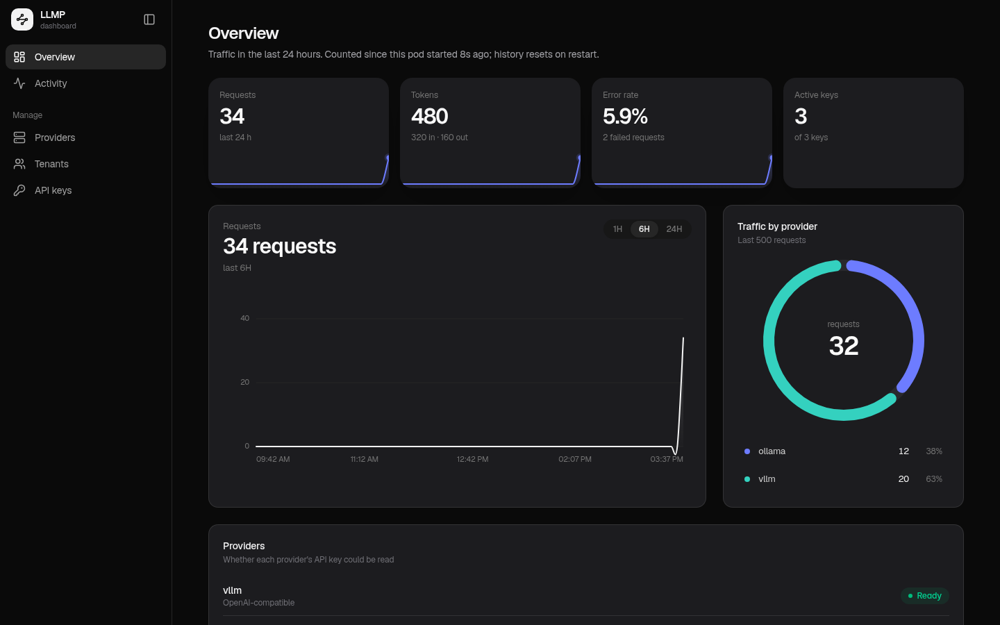

<p align="center">
  
</p>

<h1 align="center">LLMP</h1>

<p align="center">
  A Kubernetes-native LLM proxy. Give each tenant its own API key for OpenAI, Anthropic or any OpenAI-compatible model,<br>
  managed as custom resources, with limits and an audit trail. Your real provider keys never leave the cluster.
</p>

<p align="center">
  <a href="https://anas.cyberia.tn/llmp/"><b>Documentation</b></a> ·
  <a href="https://anas.cyberia.tn/llmp/guide/quick-start">Quick start</a> ·
  <a href="https://anas.cyberia.tn/llmp/guide/kubectl">kubectl &amp; GitOps</a> ·
  <a href="https://anas.cyberia.tn/llmp/guide/cli">llmproxyctl</a>
</p>

## Why

- **Provider keys stay secret.** Tenants get their own `sk-proxy-…` keys; disable, rotate or revoke one without touching the provider.
- **Configured as CRDs.** Providers, tenants and keys are Kubernetes objects: keep them in Git, deploy them with Argo CD or Flux, review them like any other manifest.
- **No passwords.** Kubernetes RBAC decides who can change what, and the Kubernetes audit log records it.
- **Any provider.** OpenAI, Anthropic, and anything OpenAI-compatible (vLLM, Ollama, OpenRouter, Groq, DeepSeek, Azure). OpenAI clients can use Anthropic models too.
- **Rules per key.** Allowed models, IP ranges, requests and tokens per minute, scaled per tenant. Automatic failover between providers.
- **Small and boring to run.** One 32 MB distroless image, about 15 MB of memory, no database, no Redis.

## Install

```bash
helm install llmproxy oci://ghcr.io/anas1412/charts/llmp --version 0.1.0 \
  -n llmproxy-system --create-namespace
```

Without Helm: `kubectl apply -n llmproxy-system -f https://github.com/anas1412/llmp/releases/download/v0.1.0/llmp.yaml`. The image is `ghcr.io/anas1412/llmp:0.1.0`. See [Helm values](https://anas.cyberia.tn/llmp/reference/helm).

## Configure with CRDs

```yaml
apiVersion: llmproxy.llmproxy.io/v1alpha1
kind: Channel                      # a provider and its real key
metadata: { name: openai, namespace: llmproxy-system }
spec:
  type: openai
  baseURL: https://api.openai.com
  keySecretRef: { name: openai-key }
  models: [gpt-4o, gpt-4o-mini]
---
apiVersion: llmproxy.llmproxy.io/v1alpha1
kind: Group                        # a tenant: named after its namespace
metadata: { name: billing, namespace: llmproxy-system }
spec:
  channelRefs: [openai]
---
apiVersion: llmproxy.llmproxy.io/v1alpha1
kind: ProxyKey                     # a virtual key in the tenant's namespace
metadata: { name: invoice-api, namespace: billing }
spec:
  models: [gpt-4o-mini]
  rpm: 120
```

LLMP writes the virtual key into the Secret `invoice-api-llmproxy` next to the `ProxyKey`. Apps mount it and call LLMP like any OpenAI endpoint:

```bash
curl http://llmproxy.llmproxy-system:8000/v1/chat/completions \
  -H "Authorization: Bearer $LLMPROXY_KEY" -H "Content-Type: application/json" \
  -d '{"model":"gpt-4o-mini","messages":[{"role":"user","content":"Hello"}]}'
```

A complete example is in [`examples/quickstart.yaml`](examples/quickstart.yaml).

## llmproxyctl

A small CLI for status, provider checks and showing or rotating keys. It opens its own `kubectl port-forward`, so your kubeconfig is all it needs:

```bash
llmproxyctl status
llmproxyctl test channel openai
llmproxyctl rotate billing/invoice-api
```

See the [CLI guide](https://anas.cyberia.tn/llmp/guide/cli).

## Dashboard (optional)

A web view of usage, activity, providers, tenants and keys. It listens only inside the pod, with no Service and no password, so you reach it with a port-forward:

```bash
kubectl port-forward -n llmproxy-system deploy/llmproxy 8082:8082    # or: llmproxyctl dashboard
```

<p align="center">
  <a href="https://anas.cyberia.tn/llmp/guide/dashboard">
    
  </a>
</p>

## Development

One Go binary with the dashboard embedded. Needs Go 1.26+ and Node.js 24+.

```bash
cd web && npm ci && npm run build && cd ..
go test ./internal/...
helm lint charts/llmp
```

See [Development](https://anas.cyberia.tn/llmp/reference/development) for local clusters, the docs site, and regenerating screenshots and the video. Pushing a `v*` tag publishes the image, the Helm chart and a GitHub release.

## License

[ISC](LICENSE)
